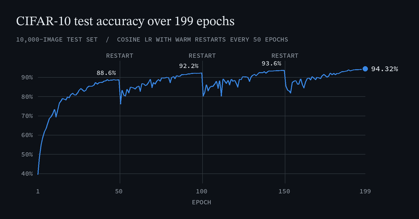

# CIFAR-10 classifier with gated parallel convolutions

A convolutional network for CIFAR-10, written in PyTorch as coursework for the Neural Networks and Deep Learning module at Queen Mary University of London (April 2025). It reaches **94.32% accuracy on the 10,000-image CIFAR-10 test set** after 199 epochs of training.



## Model

Each block runs several 3×3 convolutions (each followed by batch norm and ReLU) side by side on the same input and mixes their outputs with per-image weights. A small gating branch (global average pooling, a two-layer MLP with dropout, softmax) predicts those weights from the block's input. The mixed output passes through a 1×1 projection, is added to a skip path, then goes through batch norm and ReLU. In the code the block is `MathisBlock`, the gating branch is `ExpertBranch` and the parallel convolutions are called experts.

A 3×3 convolution stem (96 channels) feeds five blocks:

| Block | Parallel convs | Output channels | Output size |
|---|---|---|---|
| 1 | 4 | 96 | 32×32 |
| 2 | 6 | 128 | 16×16 |
| 3 | 6 | 256 | 16×16 |
| 4 | 8 | 256 | 8×8 |
| 5 | 8 | 512 | 4×4 |

A head of global average pooling, dropout (0.2) and a linear layer gives the 10 class scores. The model has 11.7M parameters.

## Training

- Augmentation: random crop with 4-pixel padding, horizontal flip, AutoAugment (CIFAR-10 policy), random erasing (p = 0.25).
- SGD with Nesterov momentum 0.9, learning rate 0.05, weight decay 5e-4, batch size 512.
- Cross-entropy loss with label smoothing 0.05.
- Cosine learning-rate schedule with warm restarts every 50 epochs (minimum 1e-5), 199 epochs in total.
- Kaiming initialisation, mixed precision and `torch.compile`, on one NVIDIA A100 80GB GPU.

## How the result was measured

94.32% is the accuracy of the final-epoch model on the standard CIFAR-10 test set (10,000 images), printed by the evaluation cell at the end of `coursework.ipynb`. It comes from a single run with no fixed seed. There is no separate validation split: the test set was also scored after every epoch to draw the training curves. The chart above is redrawn from the curve saved in the notebook.

## How to run

The code is written for a CUDA GPU.

```bash
pip install torch torchvision matplotlib tqdm jupyter
jupyter notebook coursework.ipynb
```

Run all cells. CIFAR-10 downloads to `../data` (one level above the repo) on first use. A checkpoint is saved to `checkpoints/` every 10 epochs, and training resumes from `checkpoints/latest.pth` if it exists. `utils.py` uses 10 data-loading workers; lower `get_dataloader_workers()` on smaller machines.

## Files

- `coursework.ipynb`: model, training and evaluation, with saved outputs.
- `utils.py`: data loading and augmentation, the training loop with checkpointing, and plotting helpers.
- `comp88_lab1.ipynb`: not part of the CIFAR-10 work. Lab Assignment 1 from UCL COMP0088 Introduction to Machine Learning, a warm-up on data generation and plotting, with tasks 1 and 2 done and task 3 not attempted.

## Credits

The plotting and metric helpers in `utils.py` (`Animator`, `Accumulator`, `accuracy`) are adapted from [Dive into Deep Learning](https://d2l.ai). The lab notebook is built on the [COMP0088 course materials](https://comp0088.github.io).
